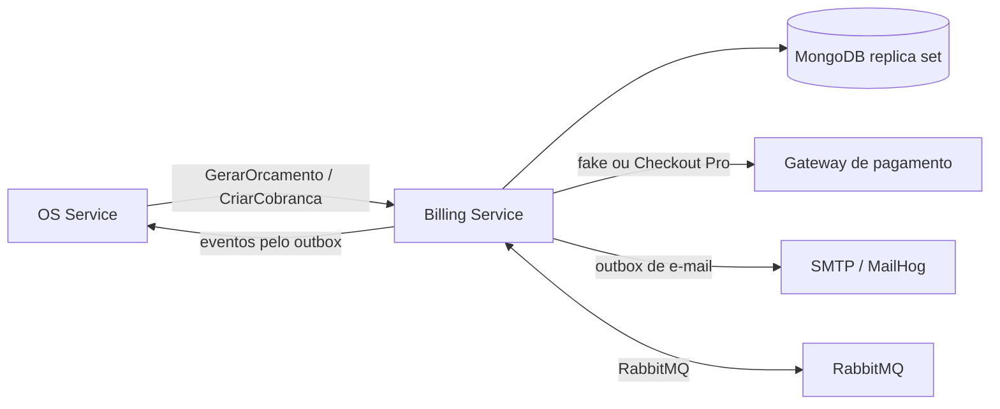

# Oficina Billing Service

Serviço de orçamentos e cobranças. Mantém snapshots imutáveis dos diagnósticos, registra a resposta do
cliente, integra com Checkout Pro do Mercado Pago e publica os eventos da Saga via RabbitMQ. Usa MongoDB
próprio; não consulta os bancos do OS Service nem do Execution Service.

## Arquitetura

- `presentation → application → domain`; adaptadores ficam em `infrastructure`.
- Orçamento/cobrança, inbox, outbox de eventos e outbox de e-mail são persistidos no MongoDB.
- Mudança de estado e outbox usam `MongoTransactionManager`; MongoDB precisa operar como replica set
  (`rs0`, inclusive com um único membro).
- Outbox AMQP só marca mensagem enviada após publisher confirm e roteamento. Inbox ignora redeliveries.
- E-mails são enfileirados na mesma transação do orçamento e enviados por um publicador separado; falhas
  SMTP ficam persistidas e são tentadas novamente.
- JWT HS256 é validado localmente; o serviço não emite tokens. Segurança está ligada por padrão.

## Requisitos e execução local

- Java 21 e o ambiente de plataforma descrito em `oficina-infra-k8s/local`.
- Configure `SPRING_MONGODB_URI` (ou `SPRING_DATA_MONGODB_URI`, aceita por compatibilidade) para o MongoDB `rs0`, `SPRING_RABBITMQ_HOST`,
  `SPRING_MAIL_HOST` e `JWT_SECRET` (HS256 com pelo menos 32 bytes). No perfil `local`, a segurança é
  desligada explicitamente e há uma chave de desenvolvimento local.
- O gateway padrão é `fake`, sem dependência de rede. `APP_PAGAMENTO_FAKE_STATUS_INICIAL` define o
  estado inicial (`PENDENTE`, `APROVADO` ou `REJEITADO`); em desenvolvimento, use
  `POST /cobrancas/{osId}/simular-pagamento` para simular uma transição. O estado fake é volátil e não deve
  ser usado para cobranças reais.
- Para executar a aplicação no perfil local: `./mvnw spring-boot:run -Dspring-boot.run.profiles=local`.
  O SMTP pode apontar para o MailHog da plataforma (1025; interface web em 8025).
- Swagger: `/swagger-ui.html`; health: `/actuator/health`.

## Gateway Mercado Pago

O adaptador usa Checkout Pro (preferência de pagamento) e o SDK Java oficial. Para habilitá-lo, defina
`APP_PAGAMENTO_GATEWAY=mercadopago`, `MP_ACCESS_TOKEN`, `MP_WEBHOOK_SECRET`, `MP_NOTIFICATION_URL` e
`MP_BACK_URL`.
Use credenciais de teste; nunca grave credenciais no repositório. A notificação deve apontar para
`POST /webhooks/mercadopago`; em desenvolvimento, exponha a porta local com ngrok ou Cloudflare Tunnel.
O webhook valida a assinatura e consulta o pagamento na API; o payload recebido não é usado para mudar
o estado. Quando não houver URL pública, o job de consulta de cobranças pendentes serve de alternativa.

## Endpoints principais

- `GET /orcamentos/{osId}` e `POST /orcamentos/{id}/resposta`.
- `GET /cobrancas/{osId}`.
- `POST /webhooks/mercadopago`.
- `POST /cobrancas/{osId}/simular-pagamento` (somente perfis `local`/`test` e gateway fake).

## Mensageria

Consome `GerarOrcamento`, `CriarCobranca`, `CancelarCobranca` e `EstornarPagamento` da fila
`billing.comandos`. Publica `OrcamentoGerado`, `OrcamentoAprovado`, `OrcamentoRecusado`,
`CobrancaCriada`, `PagamentoConfirmado`, `PagamentoRejeitado` e `PagamentoEstornado` via outbox.
Payloads canônicos e fixtures ficam em `../oficina/documentacao/contratos_mensagens.md` e
`src/test/resources/contratos`.

## Kubernetes

`k8s/` contém o Deployment, Service, Ingress, ServiceMonitor, HPA e um MongoDB StatefulSet com PVC e
replica set `rs0`. A imagem do serviço é `ghcr.io/gabrielivo01/oficina-billing-service`.
Secrets não são versionados: exporte `JWT_SECRET`, `MONGO_ROOT_PASSWORD` e um `MONGO_REPLICA_KEY`
persistente (pode ser gerado uma vez com `openssl rand -base64 756 | tr -d '\n'`); para o gateway
Mercado Pago, exporte também `APP_PAGAMENTO_GATEWAY=mercadopago`, `MP_ACCESS_TOKEN`,
`MP_WEBHOOK_SECRET`, `MP_NOTIFICATION_URL` e `MP_BACK_URL`. Execute `scripts/create-secret.sh`. O script cria/atualiza
os Secrets diretamente no cluster e não grava valores em arquivo. Preserve `MONGO_REPLICA_KEY` para
reinicializações e upgrades do StatefulSet.

## Qualidade e demonstração

- CI: testes unitários/mockados, ArchUnit, Spotless, JaCoCo e análise SonarCloud; nenhum teste de
  integração/contêiner é selecionado.
- Fluxo de demonstração e collection Postman: [documentação da Fase 4 no OS Service](../oficina/README.md#demonstração-e-qualidade).

## Testes

Os testes unitários de domínio e os testes Mockito não iniciam MongoDB, RabbitMQ, SMTP, containers ou
serviços externos. Execute os alvos unitários direcionados com `./mvnw -Dtest='OrcamentoTest,CobrancaTest' test`.
O POM mantém JaCoCo em 80%; `verify` não é necessário para validação local de baixo custo.
